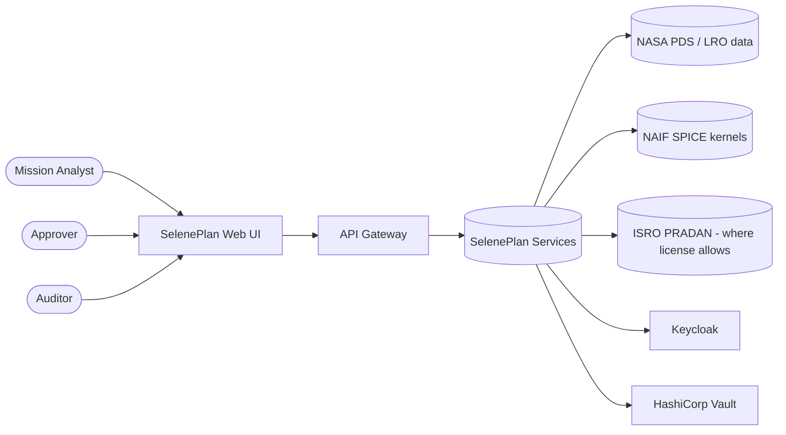
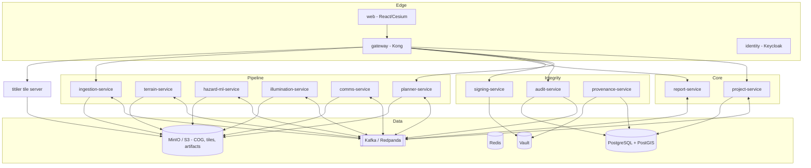
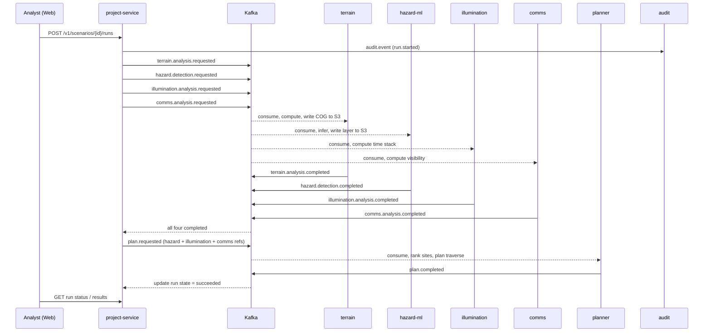

# 02. System Architecture

## 1. Architectural style
- **Microservices in a monorepo**, one deployable per bounded context.
- **Event-driven backbone** (Kafka API; Redpanda for local dev) for long-running analysis. **Synchronous REST/JSON** for user-facing queries and commands.
- **Orchestrated pipeline**: the Project Service runs a saga/state machine per scenario run (see ADR-0002).
- **Polyglot-ready, Python-first**: FastAPI services, Numba for hot loops, ONNX Runtime for inference. Heavy kernels may move to Rust later (ADR-0003).
- **Security by construction**: zero-trust network, mTLS, Vault, OPA, signed artifacts.

## 2. System context

## 3. Container view

## 4. Service catalog
| Service | Port | Language / stack | Owns (data) | Consumes events | Produces events |
|---|---|---|---|---|---|
| gateway | 8080 | Kong (DB-less) | none | none | none |
| identity | 8081 | Keycloak | users, roles, clients | none | login/admin events to audit |
| project-service | 8101 | FastAPI, SQLAlchemy | orgs, projects, scenarios, rover profiles, plans, approvals, run state | `*.completed`, `*.failed` | `*.requested`, `plan.state.changed` |
| ingestion-service | 8102 | FastAPI + worker, GDAL/Rasterio | dataset files and registry entries | `dataset.ingest.requested` | `dataset.registered`, `dataset.ingest.failed` |
| terrain-service | 8103 | FastAPI + worker, NumPy/Numba | slope, aspect, roughness rasters | `terrain.analysis.requested` | `terrain.analysis.completed` |
| hazard-ml-service | 8104 | FastAPI + worker, PyTorch to ONNX | model registry, detections | `hazard.detection.requested` | `hazard.detection.completed` |
| illumination-service | 8105 | FastAPI + worker, Numba | illumination products (time stacks) | `illumination.analysis.requested` | `illumination.analysis.completed` |
| comms-service | 8106 | FastAPI + worker, SpiceyPy | Earth visibility products | `comms.analysis.requested` | `comms.analysis.completed` |
| planner-service | 8107 | FastAPI + worker, OR-Tools/NetworkX | site rankings, routes, explanations | `plan.requested` | `plan.completed`, `plan.failed` |
| report-service | 8108 | FastAPI, WeasyPrint | report artifacts | `report.requested` | `report.completed` |
| audit-service | 8109 | FastAPI, PostgreSQL | audit log, hash chain | `audit.event` | `audit.integrity.alert` |
| signing-service | 8110 | FastAPI, Vault Transit | signatures, key metadata | none (sync API) | `plan.signed` |
| provenance-service | 8111 | FastAPI, PostgreSQL | manifests, checksums, lineage graph | `*.completed` (lineage) | none |
| web | 5173 | React, TypeScript, Vite, CesiumJS | none | none | none |

Third-party components: PostgreSQL 16 with PostGIS, MinIO, Redis, Redpanda/Kafka, Keycloak, Vault, Kong, TiTiler, OPA, Prometheus, Grafana, Loki, OpenTelemetry Collector.

## 5. Key flows

### 5.1 Scenario run (the pipeline)

Failure handling: each request has a timeout, bounded retries with backoff, and a dead-letter topic. The orchestrator marks the run `failed` with a reason, and the UI shows partial results.

### 5.2 Approval, signing, verification
1. Analyst submits plan version → state `in_review`.
2. Two **distinct** Approvers approve (OPA policy: approvers differ from the author and from each other; MFA claim required).
3. project-service asks signing-service to sign the canonical plan bytes (SHA-256 digest signed with an Ed25519 key held in Vault Transit). State → `signed`.
4. Export bundles plan, lineage, and signature. `POST /v1/verify` (public to authenticated users) re-hashes and checks.
5. Every step emits `audit.event`; the audit service appends to the hash chain.

### 5.3 Time-slice read path
UI timeline moves → request `GET /v1/products/{id}/slice?t=...` → gateway → illumination-service looks up a pre-computed band (or computes lazily) → returns a COG window through TiTiler, cached in Redis and a CDN-style HTTP cache.

## 6. Cross-cutting concerns

**Identity and authorization.** Keycloak issues short-lived JWTs (access 5 min, refresh rotation). Gateway validates tokens and rate-limits. Each service re-validates JWT signature and claims (defense in depth) and calls OPA (or a local policy library) for project-level authorization. Service-to-service calls use mTLS plus a service identity.

**Configuration and secrets.** 12-factor config. Vault supplies DB credentials (dynamic), the Transit signing key, and tokens. Local dev uses Vault dev mode and fake values.

**Observability.** OpenTelemetry in every service (traces, metrics, logs). Prometheus scrapes `/metrics`. Grafana dashboards: service RED metrics, Kafka lag, job durations, queue depth, SLOs. Loki for logs. Correlation via `trace_id` in logs and in every event envelope.

**Resilience.** Idempotent consumers (dedupe on `event_id`). Outbox pattern for DB-plus-event atomicity in project-service. Retries with jitter, circuit breakers on sync calls, DLQs, graceful shutdown.

**Data management.** Rasters are immutable, content-addressed, and versioned (COG with a manifest). Metadata lives in PostgreSQL/PostGIS. Large time stacks are stored as Zarr or banded COG sets (decide in Phase 2 via ADR).

**Multi-tenancy.** `org_id` and `project_id` on every row; row-level security in PostgreSQL; object keys prefixed by org and project.

## 7. Deployment view
- **Local:** Docker Compose (`infra/docker-compose.yml`).
- **Kubernetes:** one namespace per tier (`selene-edge`, `selene-core`, `selene-pipeline`, `selene-integrity`, `selene-data`). Helm chart per service plus an umbrella chart. Horizontal Pod Autoscaler on analysis workers using Kafka lag as the metric (KEDA). Node pool for CPU-heavy workers, optional GPU pool for ML training only.
- **Cloud (reference):** AWS: EKS, RDS PostgreSQL (PostGIS), S3, MSK or self-run Redpanda, ElastiCache, Secrets via Vault on EKS, ALB, Terraform modules. Keep cloud-specific code behind interfaces (storage, queue).
- **Environments:** `dev` (laptop), `staging`, `prod`. Promotion by Git tag; GitOps (Argo CD) optional.

## 8. Trust boundaries
1. Internet ↔ Gateway (untrusted clients).
2. Gateway ↔ Services (authenticated, rate-limited).
3. Services ↔ Data stores (least privilege, dynamic credentials).
4. Ingestion workers ↔ external data sources (egress allowlist, sandboxed).
5. ML model artifacts ↔ inference runtime (signature verification).
6. Signing service ↔ Vault (isolated network path, minimal API).

## 9. Technology decisions (summary; see `adr/`)
| Concern | Decision | ADR |
|---|---|---|
| Repo layout | Monorepo, per-service folders | 0001 |
| Messaging and orchestration | Kafka API (Redpanda local), orchestrator in project-service | 0002 |
| Language and compute | Python 3.12, FastAPI, Numba; Rust later if profiling demands | 0003 |
| Raster and time-series storage | COG on S3-compatible storage; PostGIS for vectors and metadata | 0004 |
| AuthN/Z and secrets | Keycloak, OPA, Vault | 0005 |
| Plan signing | Ed25519 via Vault Transit, canonical JSON | 0006 |

## 10. Risks
| Risk | Mitigation |
|---|---|
| Illumination compute too slow at full resolution | Horizon-profile method, tiling, Numba, coarser first pass, cache; profile early (Phase 2) |
| DEM seams, no-data regions, resolution mismatch | Mosaic and void-fill rules in ingestion, explicit no-data semantics, tests with seams |
| ML detector quality on shadowed terrain | Report confidence and recall limits, never present as ground truth, gate hazards by confidence threshold |
| Scientific incorrectness | Golden tests, comparison with published illumination maps, independent review |
| Scope creep | Strict phases, thin vertical slice first, backlog for extras |
| Dataset license limits | Data catalog records license; block redistribution flags in exports |
