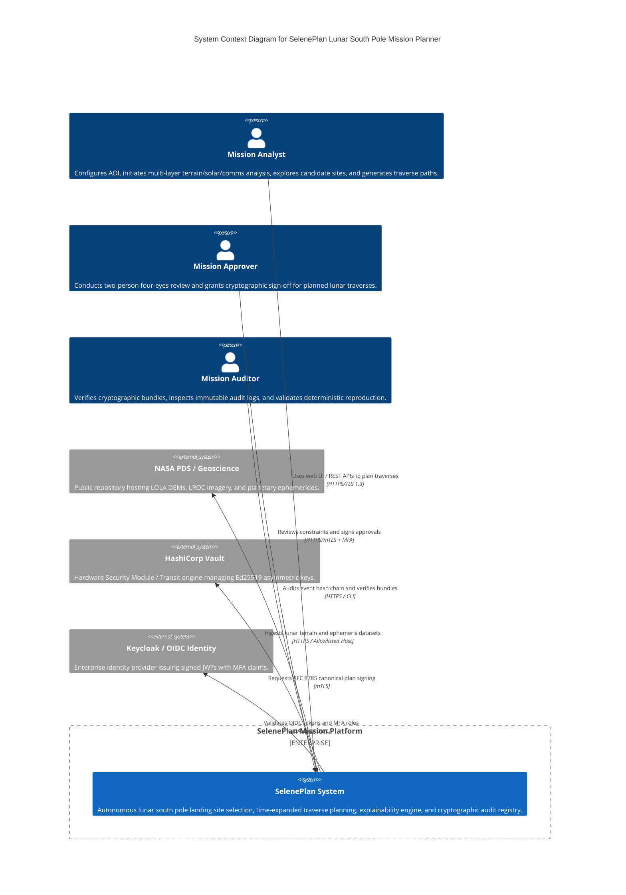
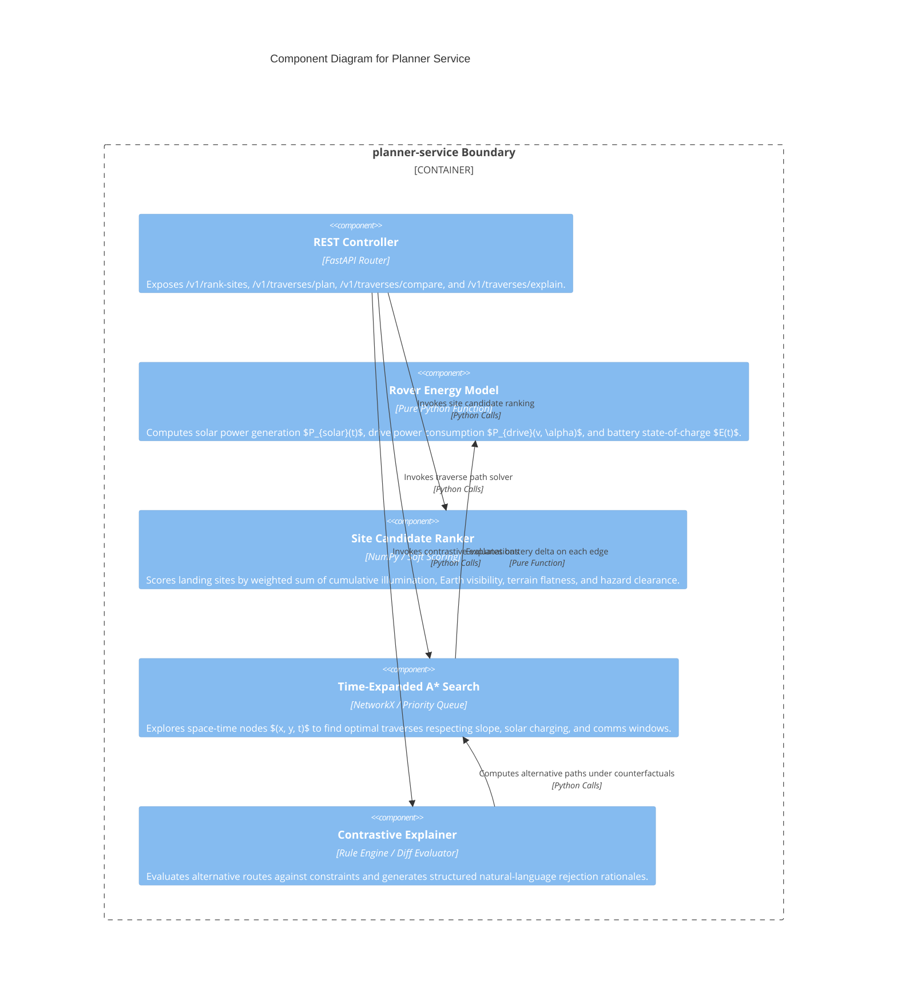
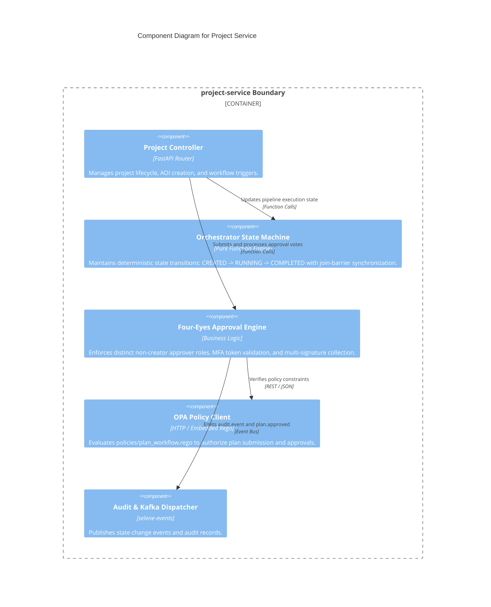

# Architecture: C4 Model Diagrams for SelenePlan

This document contains C4 architecture models (Context, Container, and Component levels) for SelenePlan expressed in standard Mermaid syntax.

---

## 1. Level 1: System Context Diagram

The System Context diagram illustrates how external users (Analyst, Approver, Auditor) and external systems interact with the SelenePlan platform.



---

## 2. Level 2: Container Diagram

The Container diagram breaks down SelenePlan into its high-level microservices, data stores, and event brokers.

```mermaid
C4Container
    title Container Diagram for SelenePlan Microservices Architecture

    Person(user, "Mission Operator", "Analyst, Approver, or Auditor")

    Container_Boundary(c0, "SelenePlan Platform Boundary") {
        Container(web, "Web Application", "React, TypeScript, Vite, TailwindCSS", "Provides interactive lunar 2D/3D map viewport, dual timelines, traverse charts, and approval panels.")
        Container(gateway, "API Gateway", "FastAPI / Kong / Envoy", "Terminates mTLS, validates JWTs, applies rate limits, and routes requests.")

        Container(project_svc, "project-service", "Python, FastAPI, SQLAlchemy", "Orchestrates multi-phase analysis workflows, manages project state machines, and enforces four-eyes approvals.")
        Container(planner_svc, "planner-service", "Python, NumPy, NetworkX", "Site ranking via soft scoring, time-expanded A* traverse search, and contrastive what-if explanations.")
        Container(hazard_svc, "hazard-ml-service", "Python, ONNX Runtime, OpenCV", "Tiled crater and rock detection using signed ONNX models, circular NMS deduplication, and hazard fusion.")
        Container(illum_svc, "illumination-service", "Python, selene-horizon, SPICE", "Horizon elevation profiling, SPICE Sun ephemerides, and Zarr timestack solar availability computation.")
        Container(comms_svc, "comms-service", "Python, selene-geo, SPICE", "Earth line-of-sight raytracing, libration modeling, and communication contact window extraction.")
        Container(terrain_svc, "terrain-service", "Python, selene-geo, GDAL", "Cloud-Optimized GeoTIFF sampling, slope calculation in radians, and roughness estimation.")
        Container(signing_svc, "signing-service", "Python, cryptography, RFC 8785", "Canonicalizes plan JSON payloads and produces Ed25519 cryptographic signatures via Vault Transit.")
        Container(audit_svc, "audit-service", "Python, FastAPI, PostgreSQL", "Maintains tamper-evident SHA-256 hash-chained audit log with periodic WORM S3 anchoring.")
        Container(report_svc, "report-service", "Python, Jinja2, WeasyPrint", "Generates verifiable HTML/PDF mission briefing packets, GeoJSON layers, and CSV waypoints.")
        Container(prov_svc, "provenance-service", "Python, FastAPI, NetworkX", "Records directed acyclic graph (DAG) data lineage and verifies artifact integrity.")

        ContainerDb(pg, "PostgreSQL 16", "Relational Database", "Stores projects, state machines, user actions, and audit hash chain.")
        ContainerDb(s3, "MinIO / S3", "Object Storage", "Stores terrain COGs, Zarr illumination timestacks, crater rasters, and signed report bundles.")
        ContainerDb(kafka, "Apache Kafka", "Message Broker", "Decouples asynchronous analysis requests, step progress updates, and audit events.")
    }

    Rel(user, web, "Interacts with", "HTTPS")
    Rel(web, gateway, "API Requests", "HTTPS/JSON")
    Rel(gateway, project_svc, "Routes to", "Internal mTLS")
    Rel(gateway, planner_svc, "Routes to", "Internal mTLS")
    Rel(project_svc, kafka, "Publishes analysis tasks", "SASL_PLAINTEXT")
    Rel(kafka, illum_svc, "Consumes step requests", "SASL_PLAINTEXT")
    Rel(kafka, comms_svc, "Consumes step requests", "SASL_PLAINTEXT")
    Rel(kafka, hazard_svc, "Consumes step requests", "SASL_PLAINTEXT")
    Rel(kafka, terrain_svc, "Consumes step requests", "SASL_PLAINTEXT")
    Rel(project_svc, signing_svc, "Requests signature upon approval", "mTLS")
    Rel(project_svc, report_svc, "Requests bundle generation", "mTLS")
    Rel(project_svc, audit_svc, "Emits audit.event", "mTLS / Kafka")
    Rel(all, prov_svc, "Registers lineage nodes", "mTLS")
    Rel(all, pg, "Reads/Writes relational state", "SQL / TLS")
    Rel(all, s3, "Reads/Writes rasters and arrays", "S3 API / TLS")
```

---

## 3. Level 3: Component Diagram – Planner Service

The Component diagram details the internal software architecture of `services/planner-service/`.



---

## 4. Level 3: Component Diagram – Project Service

The Component diagram details the orchestrator and approval engine within `services/project-service/`.


